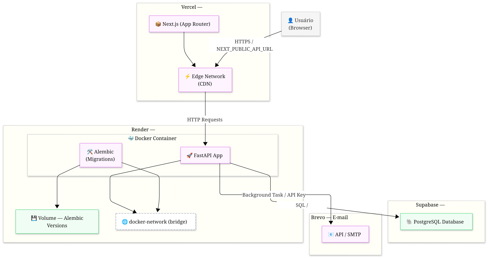

# 📑 Technical Dossier — FiveLib

---

## 1. Project Identification

| Field | Value |
| --- | --- |
| **System Name** | FiveLib (Successor to DevAcademicX) |
| **Segment** | Documentation centralization and developer tools indexing platform |
| **Version** | 1.0.0 |
| **Consolidation Date** | May 2026 |
| **Website** | [fivelib.vercel.app](https://fivelib.vercel.app/) |
| **Repository** | [github.com/fivelibx/fivelib](https://github.com/fivelibx/fivelib) |

### Engineering Team

| Name | Role / Title | Contribution Focus |
| --- | --- | --- |
| **Lucas Paiva Santos de Oliveira** | Lead Full Stack Developer & Architect | Architecture, Backend, Frontend, Infrastructure, Security |
| **Felipe Gonçalves** | Contributor | Authentication, interaction logic (Stars/Favorites) |
| **Mateus Alves Marques Macido** | Academic Collaborator | Systems modeling, PRD, ERD |
| **Rodrigo Moraes dos Santos** | Academic Collaborator | Systems modeling, business rules |
| **Nicolas Rosa Santos** | Academic Collaborator | Systems modeling, business rules |
| **Raian Luis dos Santos** | Academic Collaborator | Systems modeling, planning |

---

## 2. System Overview

### 2.1 Context and Problem

In the current software development ecosystem, information fragmentation is a critical obstacle. Developers, especially beginners, face a steep learning curve due to the dispersion of official documentation, third-party tutorials, and auxiliary tools across multiple platforms and repositories.

### 2.2 Objective

FiveLib provides a unified and curated environment that brings together essential libraries, frameworks, and technical documentation, operating on three pillars:

- **Centralization:** A single hub for consulting official links and support resources
- **Guidance:** Facilitating the onboarding of new programmers through an objective and functional interface
- **Community:** Enabling peer interaction for tool validation and sharing of technical experiences

### 2.3 Functional Scope

The project covers the following modules:

- **Search and Indexing Module (FR01):** Search engine for locating documentation, libraries, and tools, categorized by language and purpose
- **Identity Management (FR05):** User registration and authentication system for access control
- **Persistence Module — Personal Library (FR02/FR04):** Functionality for saving favorite links and managing private external references
- **Support and Feedback Module (FR03/BR04):** Contact interface (Helpdesk) for reporting issues and suggestions with an administrative moderation flow

---

## 3. Stakeholders and Actors

### 3.1 Stakeholders

| Stakeholder | Interest in the System |
| --- | --- |
| Students | Quickly locate official documentation to accelerate learning |
| Developers (Community) | Centralize links to favorite tools |
| Library Maintainers | Have their tools featured on a portal aimed at programming education |
| Teachers / Advisors | Use the platform as a centralized reference repository to recommend to students |
| System Administrators | Monitor usage, moderate content, and ensure database integrity |

### 3.2 Actors

| Actor | Description |
| --- | --- |
| **Guest User** | Unauthenticated individual who accesses the platform to browse and view links (FR01) |
| **Registered User** | Authenticated student with permission to save favorites, private links, and open tickets (FR02/FR05) |
| **Moderator** | Technical lead responsible for validating reports and approving pending content (BR04) |
| **Administrator** | Manager with full privileges to manage users and maintain the database (UC03/UC04) |

---

## 4. System Requirements

### 4.1 Functional Requirements

| ID | Requirement |
| --- | --- |
| **FR01** | The system must allow searching and filtering libraries and tools by name, language, or category |
| **FR02** | The system must allow authenticated users to store links of interest in their personal profile |
| **FR03** | The system must allow users to report broken or inactive links for moderation review |
| **FR04** | The system must allow users to add external URLs to their account privately |
| **FR05** | The system must provide registration, login, and session termination functionality |

### 4.2 Non-Functional Requirements

| ID | Requirement |
| --- | --- |
| **NFR01** | The system must be operable by users without prior training within 5 minutes of navigation |
| **NFR02** | Access to persistence features must require email-based authentication |
| **NFR03** | The interface must be compatible with screen resolutions from 360px to 1920px (Mobile and Desktop) |
| **NFR04** | Query response time must not exceed 10 seconds |
| **NFR05** | The system must be distributed as a Docker image compatible with x86_64 systems |

### 4.3 Business Rules

| ID | Rule |
| --- | --- |
| **BR01** | Account registration and support form submission are restricted to users aged 18 years or older |
| **BR02** | The system must not allow the registration of two or more users with the same email address |
| **BR03** | Preferences and links saved in the personal library (FR02/FR04) are bound to the user's ID and are not visible to other users |
| **BR04** | Every message submitted through the support form will initially receive the status "Pending" and will be visible only in the Administrator's panel |

---

## 5. Use Cases

### 5.1 Use Case Catalog

| Code | Name | Primary Actor |
| --- | --- | --- |
| UC01 | Access Home | User |
| UC02 | Save Preferences | Registered User |
| UC03 | Ban User | Administrator |
| UC04 | Restrict User | Administrator |

### 5.2 Main Flow — Search and Data Persistence

1. The user accesses the Landing Page (state: Guest)
2. The user performs a search or filter by language/tool (FR01)
3. The system returns the links and technical details of the selected tool
4. The user opts to log in or register to unlock personalization features (NFR02)
5. The system binds the tool or external link to the user's profile and confirms the save (FR02/FR04)

---

## 6. Infrastructure Architecture

### 6.1 Network Topology and Components

The system is based on a distributed and containerized architecture, segmenting responsibilities across the interface, logical processing, transactional messaging, and relational data persistence layers.

| Component | Technology | Platform | Responsibility |
| --- | --- | --- |--- |
| **Frontend** | Next.js 16 (App Router) | Vercel (Edge Network / CDN) | User interface, SSR, state management |
| **Backend** | FastAPI + Python 3.12+ | Render (Docker Container) | REST API, business rules, JWT authentication |
| **Database** | PostgreSQL | Supabase | Relational data persistence |
| **Messaging** | Brevo (API/SMTP) | SaaS | Asynchronous transactional email dispatch |
| **Migrations** | Alembic | Docker Volume | Database schema versioning and control |

### 6.2 Communication Flow



---

## 7. Physical Data Model

### 7.1 Entity Cardinality

| Entity A | Relationship | Entity B | Cardinality | Justification |
| --- | --- | --- | --- | --- |
| **User** | Has | **Favorite** | 0:N | A user may have no favorites or many (FR02/BR03) |
| **Tool** | Is favorited in | **Favorite** | 0:N | A tool may be new and have no favorites yet |
| **User** | Registers | **PrivateLink** | 0:N | The user decides whether to add private links (FR04/BR03) |
| **User** | Opens | **SupportTicket** | 1:N | Restricted to registered users (18+) per BR01 |
| **SupportTicket** | Belongs to | **User** | 1:1 | Each ticket is mandatorily linked to an author (BR04) |

### 7.2 Entity: `user` (Users)

**Purpose:** Identity management, account activation flow control, credential recovery, terms compliance, and access profiles (FR05).

**PK:** `id` | **FK:** None

| Attribute | Type | Constraints | Description |
| --- | --- | --- | --- |
| `id` | `int4` | PK, DEFAULT nextval() | Unique auto-incremented identifier |
| `nome` | `VARCHAR(255)` | NOT NULL | User's full name |
| `email` | `VARCHAR(255)` | NOT NULL, UNIQUE | Institutional or personal email |
| `senha` | `VARCHAR(255)` | NOT NULL | Cryptographic password hash |
| `data_nascimento` | `DATE` | NOT NULL | Date of birth for age validation (BR01) |
| `perfil` | `VARCHAR(255)` | NOT NULL, CHECK | Access level in the system |
| `criado_at` | `TIMESTAMPTZ` | NOT NULL, DEFAULT NOW() | Account creation timestamp |
| `is_active` | `BOOLEAN` | DEFAULT FALSE | Account activation status via email |
| `verification_code` | `VARCHAR` | NULLABLE | Temporary code for account activation |
| `verification_expires_at` | `TIMESTAMPTZ` | NULLABLE | Activation code expiration window |
| `accepted_terms` | `BOOLEAN` | DEFAULT FALSE | Terms of use acceptance flag |
| `accepted_terms_at` | `TIMESTAMPTZ` | NULLABLE | Timestamp of terms acceptance |
| `reset_password_code` | `TEXT` | NULLABLE | Credential recovery token |
| `reset_password_expires_at` | `TIMESTAMPTZ` | NULLABLE | Recovery token expiration |
| `titulo_profissional` | `VARCHAR(150)` | NULLABLE | Technical title displayed on the profile |
| `github` | `VARCHAR(50)` | NULLABLE | GitHub profile username |
| `linkedin` | `VARCHAR(50)` | NULLABLE | LinkedIn profile username |

> **Constraint:** `CHECK (perfil IN ('superadmin', 'admin', 'moderador', 'user'))`

### 7.3 Entity: `tool` (Tools/Technologies)

**Purpose:** Centralized catalog of technologies, libraries, and frameworks with visual metadata indexing (FR01).

**PK:** `id` | **FK:** None

| Attribute | Type | Constraints | Description |
| --- | --- | --- | --- |
| `id` | `int4` | PK, DEFAULT nextval() | Unique auto-incremented identifier |
| `nome` | `VARCHAR(255)` | NOT NULL, UNIQUE | Library or framework name |
| `descricao` | `TEXT` | NOT NULL | Simplified technical description |
| `url_oficial` | `TEXT` | NOT NULL | Link to official documentation |
| `linguagem` | `VARCHAR(255)` | NOT NULL | Primary ecosystem language |
| `status_ativo` | `BOOLEAN` | NOT NULL, DEFAULT TRUE | Tool visibility in the app |
| `stars` | `int4` | NOT NULL, DEFAULT 0 | Global favorites counter |
| `tags` | `VARCHAR(255)[]` | NOT NULL, DEFAULT '{}' | Sub-technology array (e.g. `{UI, SPA}`) |
| `categoria` | `VARCHAR(255)` | NOT NULL, DEFAULT 'Geral' | Primary category for filters |
| `icon_slug` | `VARCHAR(255)` | NULLABLE | Icon identifier slug (Lucide React) |

### 7.4 Entity: `favorite` (N:N Junction Table)

**Purpose:** Persistence of items favorited by users (FR02).

**Composite PK:** (`usuario_id`, `ferramenta_id`) | **FK:** `usuario_id`, `ferramenta_id`

| Attribute | Type | Constraints | Description |
| --- | --- | --- | --- |
| `usuario_id` | `int4` | PK, FK (`user.id`) | Reference to the user's id |
| `ferramenta_id` | `int4` | PK, FK (`tool.id`) | Reference to the tool's id |
| `adicionado_at` | `TIMESTAMPTZ` | NOT NULL, DEFAULT NOW() | Favorite action timestamp |

### 7.5 Entity: `private_link` (Custom Links)

**Purpose:** Storage of external and personalized URLs registered by the user (FR04/BR03).

**PK:** `id` | **FK:** `usuario_id`

| Attribute | Type | Constraints | Description |
| --- | --- | --- | --- |
| `id` | `int4` | PK, DEFAULT nextval() | Unique auto-incremented identifier |
| `usuario_id` | `int4` | FK (`user.id`), NOT NULL | Private link owner |
| `titulo` | `VARCHAR(255)` | NOT NULL | User-defined friendly name for the link |
| `url` | `TEXT` | NOT NULL | External URL saved by the user |

### 7.6 Entity: `support_ticket` (Support Tickets)

**Purpose:** Channel for bug reports, technical feedback, and internal auditing via the administrative panel (FR03/BR04).

**PK:** `id` | **FK:** `usuario_id`

| Attribute | Type | Constraints | Description |
| --- | --- | --- | --- |
| `id` | `int4` | PK, DEFAULT nextval() | Unique auto-incremented identifier |
| `usuario_id` | `int4` | FK (`user.id`), NOT NULL | Authenticated author who created the ticket |
| `email_contato` | `VARCHAR(255)` | NOT NULL | Contact email for resolution follow-up |
| `mensagem` | `TEXT` | NOT NULL | Ticket or bug description |
| `secao_site` | `VARCHAR(255)` | NOT NULL | Context/Page where the issue occurred |
| `status` | `VARCHAR(255)` | NOT NULL, DEFAULT 'Pendente' | Ticket workflow state |
| `criado_at` | `TIMESTAMPTZ` | NOT NULL, DEFAULT NOW() | Ticket creation timestamp |
| `observacao_admin` | `TEXT` | NULLABLE | Internal note added by moderation/admin |

> **Ticket states:** `'Pendente'` → `'Em Análise'` → `'Resolvido'`

### 7.7 Physical Indexes and Constraints

| Index | Purpose |
| --- | --- |
| `user_email_unique` | Ensures no two registrations share the same email address |
| `tool_nome_unique` | Prevents duplicate tools with the same name |
| `favorite_usuario_id_idx` | Optimizes lookup of all tools favorited by a specific user |
| `favorite_ferramenta_id_idx` | Speeds up counting of users who favorited a given tool |
| `favorite_adicionado_at_idx` | Chronological ordering of favorites |
| `private_link_usuario_id_idx` | Accelerates loading of the custom links library on the dashboard |
| `support_ticket_usuario_id_idx` | Quickly links ticket history by user ID |
| `support_ticket_status_idx` | Used by the admin panel to filter tickets with `'Pendente'` status |

---

## 8. REST API Endpoint Specification

**Base URL (Local):** `http://localhost:8001/api/v1`
**Content-Type:** `application/json`
**Authentication:** Bearer JWT (`Authorization: Bearer <token>`)

### 8.1 Authentication and User Lifecycle

| Method | Route | Authentication | Description |
| --- | --- | --- | --- |
| `POST` | `/auth/register` | Public | Registration. Validates age (18+). Saves with `is_active=false`. Sends verification code via Brevo (Background Task) |
| `POST` | `/auth/verify` | Public | Account activation. Compares the code and sets `is_active` to `true` if valid |
| `POST` | `/auth/login` | Public | Authentication. Returns a JWT Token if credentials are valid and `is_active=true` |
| `POST` | `/auth/forgot-password` | Public | Generates a temporary reset code and dispatches it via Brevo |
| `POST` | `/auth/reset-password` | Public | Consumes the generated code and updates the password hash in the database |

### 8.2 Tools — Resource Catalog

| Method | Route | Authentication | Description |
| --- | --- | --- | --- |
| `GET` | `/resources` | Public | Paginated listing of active tools. Supports queries by `q`, `linguagem`, `categoria`, and `tag` |
| `POST` | `/resources` | JWT (`admin` / `superadmin`) | Resource creation. Route protected by role middleware in the JWT |

### 8.3 Personal Dashboard and Private Links

| Method | Route | Authentication | Description |
| --- | --- | --- | --- |
| `GET` | `/users/me` | JWT | Consolidated data of the authenticated user |
| `PUT` | `/users/me` | JWT | Profile update and insertion of social profiles (`github`, `linkedin`, `titulo_profissional`) |
| `GET` | `/users/me/favorites` | JWT | List of `Tool` objects marked as favorites |
| `POST` | `/users/me/favorites` | JWT | Favorite toggle (inserts or removes the record and updates the `stars` counter) |
| `POST` | `/users/me/custom-links` | JWT | Persists records in the `private_link` table |

### 8.4 Support and Moderation Channel

| Method | Route | Authentication | Description |
| --- | --- | --- | --- |
| `POST` | `/support/tickets` | JWT | Inserts a new row in `support_ticket` with initial status `'Pendente'` |
| `PATCH` | `/support/tickets/{id}` | JWT (`moderador` / `admin`) | Updates the ticket status and allows attaching notes in `observacao_admin` |

---

## 9. Information Security Strategies

### 9.1 Implemented Controls

| Control | Description |
| --- | --- |
| **Credential Isolation** | No key (`DATABASE_URL`, `JWT_SECRET`, `BREVO_API_KEY`) resides in committed files. Injection occurs exclusively at runtime via the Render and Vercel platforms |
| **Restricted CORS** | FastAPI's CORS middleware is locked at the domain level, rejecting requests from origins that do not match the Vercel production URL |
| **Structural Validation** | Input and output payloads are enforced by declarative schemas from **Pydantic** (backend) and **Zod** (frontend), blocking malformed payload injections |
| **Token Isolation** | Variables without the `NEXT_PUBLIC_` prefix are never exposed to the browser, operating exclusively in Server-Side Components |
| **Password Hashing** | Cryptographic hashing via `bcrypt` — credentials are never stored in plain text |
| **Temporary Tokens** | Activation and password recovery codes have an expiration window (`verification_expires_at`, `reset_password_expires_at`) |

### 9.2 Security Audit Results

**Date:** 05/14/2026 | **Responsible:** Lucas Paiva Santos de Oliveira
**Analyzed branch:** `develop` | **Environment:** Python 3.12+ / Node.js 22 / Docker

#### Tools Used

| Tool | Version | Purpose |
| --- | --- | --- |
| `safety` | 3.7.0 | Python dependency vulnerabilities |
| `bandit` | 1.9.4 | Python code static security analysis |
| `npm audit` | — | JavaScript dependency vulnerabilities |
| `hadolint` | latest | Dockerfile best practices |
| `trufflehog` | 2.2.1 | Detection of exposed secrets in Git history |

#### Results by Layer

| Layer | Status | Notes |
| --- | --- | --- |
| Python Dependencies (`safety`) | ✅ Approved | `PyJWT` updated from 2.10.1 → ≥2.12.0 during the audit (CVE-2026-32597) |
| Python Code (`bandit`) | ✅ Approved | 1 false positive: `"bearer"` in `auth.py:43` — standard OAuth2 token type (RFC 6750), not a hardcoded password |
| JavaScript Dependencies (`npm audit`) | ✅ Approved | 2 false positives: `postcss <8.5.10` reported against `next@16.2.6`, which already includes the fix internally |
| Dockerfiles (`hadolint`) | ✅ Approved | No issues found in `backend/Dockerfile` or `frontend/Dockerfile` |
| Git Secrets (`trufflehog`) | ✅ Approved | Only example/placeholder strings found (`.env.example`, `alembic.ini`) — no real credentials exposed |

**Overall result: APPROVED for merge into `main`** ✅

#### Dependencies Pending Update

**Backend:**

| Package | Current Version | Latest Version | Action |
| --- | --- | --- | --- |
| `bcrypt` | 4.1.2 | 5.0.0 | Update after delivery — major, test compatibility |
| `websockets` | 15.0.1 | 16.0 | Update — `supabase-py` dependency |
| `PyJWT` | 2.12.0+ | 2.12.0+ | ✅ Updated during audit |

**Frontend:**

| Package | Current Version | Latest Version | Action |
| --- | --- | --- | --- |
| `zod` | 3.25.76 | 4.4.3 | Defer — breaking changes in v4 |
| `typescript` | 5.7.3 | 6.0.3 | Defer — breaking changes in v6 |
| `lucide-react` | 0.564.0 | 1.16.0 | Defer — major version |
| `recharts` | 2.15.0 | 3.8.1 | Defer — major version |
| `sonner` | 1.7.4 | 2.0.7 | Defer — major version |

> Major version updates were intentionally deferred to avoid breaking changes close to the delivery deadline. A review is recommended after the final presentation.

---

## 10. Development Process

### 10.1 Methodology — Kanban (Continuous Flow)

Kanban was adopted due to the need for flexibility for a team of 5 developers. It enables a constant workflow where tasks (Issues) transition between states without the need for closed cycles (Sprints).

**Workflow:** `To Do (Backlog)` → `In Progress` → `Review (Code Review)` → `Done`

**Management:** [GitHub Projects](https://github.com/orgs/devacademicx/projects/1)

**Advantages for this context:**

- Absence of complex formal roles allows focus on technical execution
- Real-time visual board for identifying bottlenecks
- WIP (Work in Progress) limits to prevent team member overload

### 10.2 Development Guidelines

| Guideline | Description |
| --- | --- |
| **Decoupling** | Frontend and Backend operate as isolated entities. No business logic should reside in the interface |
| **API-Driven** | All features must be modeled and exposed via endpoints before any Frontend implementation |
| **Conventional Commits** | Mandatory use of the `feat/`, `fix/`, `docs/`, `chore/` pattern for Git history integrity |
| **Documentation First** | All technical specifications are maintained in isolation within the `/docs` directory |

---

## 11. Risk Management

| Risk | Impact | Mitigation |
| --- | --- | --- |
| **Environment Incompatibility** | High — the system may not run on all developers' machines | Use of Docker to standardize the environment (NFR05) |
| **API Integration Delay** | Medium — Frontend may be blocked waiting for Backend routes | Pre-definition of the API contract and use of static data (mocks) for testing |
| **Low Link Quality** | Medium — the platform may lose credibility with broken URLs | Implementation of the Link Reporting system (FR03) and active moderation |
| **Database Data Loss** | High — SQL migration failures may corrupt tables | Periodic data volume backups and schema version control via Alembic |

---

## 12. Roadmap — Future Evolutions

| Evolution | Description | Technical Objective |
| --- | --- | --- |
| **Native Mobile App** | Android/iOS application using the same Backend API | Cross-platform architecture without duplicating logic |
| **Study Gamification** | Achievement system and learning tracks for beginners | Increase engagement and student retention |
| **AI Integration** | Assistant to suggest libraries based on the developer's profile | Search experience personalization via LLMs |
| **Third-Party API** | Exposure of the database for querying by other systems | Transform FiveLib into a Data Provider |

---

## 13. How to Run

The development environment is fully containerized via Docker.

```bash
# Start the full ecosystem (Frontend, Backend, and Database)
make up

# Alternative without Makefile
docker-compose up --build
```

**Required environment variables (never to be committed):**

| Variable | Component | Description |
| --- | --- | --- |
| `DATABASE_URL` | Backend | Connection URL to Supabase's PostgreSQL |
| `JWT_SECRET` | Backend | Secret key for signing JWT tokens |
| `BREVO_API_KEY` | Backend | API key for transactional email dispatch |
| `NEXT_PUBLIC_API_URL` | Frontend | Public API URL (Render) |

---

## 14. Conclusion

FiveLib consolidates documentation and tools to guide students and programmers in an environment of fragmented information. The platform delivers an objective solution that optimizes search and serves as a practical guide for the technical development of its users.

The elaboration of this specification provided the team with a broad and applied view of Software Engineering. The mapping of actors, use cases, functional and non-functional requirements, and business rules establishes the foundation for mitigating risks and aligning scope, ensuring that the implementation phases proceed in an organized, assertive, and scalable manner.
